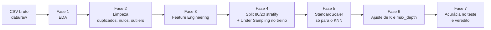

# PrevMaq — Previsão de Falhas em Máquinas Industriais

> ✏️ *Troque o nome do projeto se quiser e apague as notas marcadas com ✏️ antes da entrega.*

Pipeline de Ciência de Dados em Python que prevê se um equipamento vai **falhar** (`falha_maquina = 1`) ou **operar normalmente** (`falha_maquina = 0`) a partir de leituras de sensores. Projeto Avaliativo do Módulo 1 da trilha **Desenvolvimento de IA para Análise Preditiva [T3]** (SENAI/SC).

📹 **Vídeo de apresentação:** ✏️ *[cole aqui o link do Google Drive]*

---

## 1. Problema

Um parque fabril monitorado por sensores precisa antecipar quebras mecânicas para evitar paradas não programadas na linha de produção. O objetivo é treinar um classificador binário que, a partir de temperatura, rotação, torque e desgaste da ferramenta, indique se há risco de falha.

## 2. Dados

| Item | Descrição |
|---|---|
| Arquivo | `data/raw/manutencao_preditiva.csv` |
| Origem | Base histórica fornecida no enunciado do Projeto Avaliativo (SENAI/SC) |
| Granularidade | Um registro de operação de equipamento por linha |
| Variável alvo (y) | `falha_maquina` (1 = falha, 0 = normal) |
| Dicionário de dados | [`docs/dicionario_de_dados.md`](docs/dicionario_de_dados.md) |

**Colunas excluídas das preditoras:** `udi` e `id_produto` são identificadores e não descrevem o funcionamento da máquina. `falha_twf`, `falha_hdf`, `falha_pwf`, `falha_osf` e `falha_rnf` registram o motivo da falha depois que ela acontece. Por orientação do Departamento de Engenharia, ficam fora para evitar vazamento de dados (*data leakage*).

## 3. Técnicas e tecnologias

**Linguagem e bibliotecas:** Python, pandas, NumPy, Matplotlib, Seaborn, scikit-learn, Jupyter Notebook.

**Etapas do pipeline:**



| Fase | O que é feito |
|---|---|
| 1. Análise Exploratória (EDA) | Dimensões, tipos, `.describe()`, histogramas, gráfico de barras do alvo e mapa de calor de correlação de Pearson. |
| 2. Limpeza (Data Prep) | Remoção de duplicados, imputação de nulos por média ou mediana (com justificativa) e boxplots para outliers. |
| 3. Feature Engineering | Criação da coluna ✏️ *`potencia = velocidade_rotacao_rpm * torque_nm` (ou a combinação que você escolher)*. |
| 4. Divisão e balanceamento | Separação X/y, `train_test_split` 80/20 com `stratify=y` e **Random Under Sampling** feito com pandas, aplicado só no treino. |
| 5. Escalonamento | `StandardScaler` (`fit_transform` no treino e `transform` no teste) só para o KNN. A Árvore de Decisão usa os dados sem escala. |
| 6. Ajuste de hiperparâmetros | KNN com K ✏️ *(3, 5, 7…)* e Árvore com `max_depth` ✏️ *(3, 5, None…)*, comparando acurácia de treino e teste. |
| 7. Avaliação final | Acurácia no teste do melhor KNN e da melhor Árvore, com o modelo recomendado. |

## 4. Estrutura do repositório

```
manutencao-preditiva/
├── data/
│   └── raw/
│       └── manutencao_preditiva.csv   # base original (não editar)
├── docs/
│   └── dicionario_de_dados.md         # descrição das colunas
├── notebooks/
│   └── projeto_manutencao_preditiva.ipynb   # pipeline completo (Fases 1 a 7)
├── outputs/                           # gráficos exportados (opcional)
├── requirements.txt                   # dependências
└── README.md
```

## 5. Como executar

Pré-requisitos: Python 3.11+ e Git instalados.

```bash
# 1. Clonar o repositório
git clone ✏️https://github.com/SEU-USUARIO/manutencao-preditiva.git
cd manutencao-preditiva

# 2. (Opcional) Criar e ativar um ambiente virtual
python -m venv .venv
# Windows
.venv\Scripts\activate
# Linux/Mac
source .venv/bin/activate

# 3. Instalar as dependências
pip install -r requirements.txt

# 4. Abrir o notebook
jupyter notebook notebooks/projeto_manutencao_preditiva.ipynb
```

No Jupyter, use **Kernel → Restart & Run All**. O notebook lê o CSV por caminho relativo (`../data/raw/manutencao_preditiva.csv`), então funciona em qualquer máquina sem ajuste.

## 6. Resultados

> ✏️ *Preencha depois de rodar o notebook.*

| Modelo | Hiperparâmetro | Acurácia treino | Acurácia teste |
|---|---|---|---|
| KNN | K = ✏️ | ✏️ | ✏️ |
| KNN | K = ✏️ | ✏️ | ✏️ |
| KNN | K = ✏️ | ✏️ | ✏️ |
| Árvore de Decisão | max_depth = ✏️ | ✏️ | ✏️ |
| Árvore de Decisão | max_depth = ✏️ | ✏️ | ✏️ |
| Árvore de Decisão | max_depth = ✏️ | ✏️ | ✏️ |

**Modelo recomendado:** ✏️ *nome e configuração, acurácia no teste e por que foi escolhido.*

## 7. Organização das tarefas e branches

O projeto segue o **Git Flow**:

| Branch | Objetivo |
|---|---|
| `main` | Versão final e estável do projeto. |
| `develop` | Integra as funcionalidades durante o desenvolvimento. |
| `feature/estrutura-projeto` | Pastas, base de dados, dicionário de dados, requirements e README inicial. |
| `feature/roteiro-notebook` | Notebook com a estrutura das 7 fases. |
| ✏️ `feature/fase-1-eda` | Análise exploratória. |
| ✏️ `feature/fase-2-limpeza` | Limpeza e tratamento de dados. |
| ✏️ `feature/fase-3-feature-engineering` | Criação da nova variável. |
| ✏️ `feature/fase-4-divisao-balanceamento` | Split treino/teste e under sampling. |
| ✏️ `feature/fase-5-escalonamento` | StandardScaler para o KNN. |
| ✏️ `feature/fase-6-ajuste-parametros` | Variação de K e max_depth. |
| ✏️ `feature/fase-7-avaliacao-final` | Acurácia final e veredito. |
| ✏️ `feature/readme-final` | Resultados e link do vídeo no README. |

✏️ *Explique em poucas linhas como você planejou as tarefas antes de começar (ex.: quadro Kanban, lista por fase, prazos).*

## 8. Melhorias futuras

> ✏️ *Escreva com suas palavras o que poderia melhorar. Algumas ideias:*

- Avaliar com outras métricas além da acurácia, já que errar uma falha real custa mais do que um alarme falso.
- Comparar o Random Under Sampling com outras técnicas de balanceamento, como o SMOTE.
- Testar mais valores de K e de `max_depth`.
- Transformar as fases em scripts `.py` reutilizáveis em `src/`.

## 9. Autoria

✏️ *Seu nome completo* — Trilha Profissionalizar · Desenvolvimento de IA para Análise Preditiva [T3] · SENAI/SC
