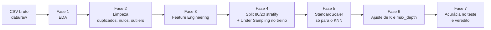

# PrevMaq — Previsão de Falhas em Máquinas Industriais

Pipeline de Ciência de Dados em Python que prevê se um equipamento vai **falhar** (`falha_maquina = 1`) ou **operar normalmente** (`falha_maquina = 0`) a partir de leituras de sensores. Projeto Avaliativo do Módulo 1 da trilha **Desenvolvimento de IA para Análise Preditiva [T3]** (SENAI/SC).

📹 **Vídeo de apresentação:** *[Em produção]*

---

## 1. Problema

Um parque fabril monitorado por sensores precisa antecipar quebras mecânicas para evitar paradas não programadas na linha de produção. O objetivo é treinar um classificador binário que, a partir de temperatura, rotação, torque e desgaste da ferramenta, indique se há risco de falha.

## 2. Dados

| Item | Descrição |
|---|---|
| Arquivo | `data/raw/manutencao_preditiva.csv` |
| Origem | Base histórica fornecida no enunciado do Projeto Avaliativo (SENAI/SC) |
| Granularidade | Um registro de operação de equipamento por linha |
| Variável alvo (y) | `falha_maquina` (1 = falha, 0 = normal) |
| Dicionário de dados | [`docs/dicionario_de_dados.md`](docs/dicionario_de_dados.md) |

**Colunas excluídas das preditoras:** `udi` e `id_produto` são identificadores e não descrevem o funcionamento da máquina. `falha_twf`, `falha_hdf`, `falha_pwf`, `falha_osf` e `falha_rnf` registram o motivo da falha depois que ela acontece. Por orientação do Departamento de Engenharia, ficam fora para evitar vazamento de dados (*data leakage*).

## 3. Técnicas e tecnologias

**Linguagem e bibliotecas:** Python, pandas, NumPy, Matplotlib, Seaborn, scikit-learn, Jupyter Notebook.

**Etapas do pipeline:**



| Fase | O que é feito |
|---|---|
| 1. Análise Exploratória (EDA) | Dimensões, tipos, `.describe()`, histogramas, gráfico de barras do alvo e mapa de calor de correlação de Pearson. |
| 2. Limpeza (Data Prep) | Verificação de duplicados (nenhum encontrado). Os 500 registros sem leitura dos sensores foram imputados com **média** nas variáveis simétricas (temperaturas e torque) e **mediana** na rotação, que é assimétrica. Boxplots mostraram outliers de rotação e torque, que foram **mantidos** porque concentram falhas (70,6% dos outliers de torque são falhas). |
| 3. Feature Engineering | Criação da coluna `potencia = velocidade_rotacao_rpm * torque_nm`, proporcional à potência mecânica do motor (sem valores ausentes). |
| 4. Divisão e balanceamento | X com 7 preditoras (`tipo` convertida para 0/1/2 com `.map()`), `train_test_split` 80/20 com `stratify=y` e **Random Under Sampling** feito com pandas só no treino (271 falhas + 271 normais). O teste fica intocado. |
| 5. Escalonamento | `StandardScaler` (`fit_transform` no treino e `transform` no teste) só nas variáveis contínuas do KNN. A Árvore de Decisão usa os dados sem escala. |
| 6. Ajuste de hiperparâmetros | KNN com K = 1, 3, 5, 7, 9, 11 e 15; Árvore com `max_depth` = 3, 5, 7, 10 e None, comparando acurácia de treino e teste para identificar overfitting. |
| 7. Avaliação final | Acurácia no teste do melhor KNN e da melhor Árvore, com o modelo recomendado. |

## 4. Estrutura do repositório

```
manutencao-preditiva/
├── data/
│   └── raw/
│       └── manutencao_preditiva.csv   # base original (não editar)
├── docs/
│   └── dicionario_de_dados.md         # descrição das colunas
├── notebooks/
│   └── projeto_manutencao_preditiva.ipynb   # pipeline completo (Fases 1 a 7)
├── outputs/                           # gráficos exportados
├── requirements.txt                   # dependências
└── README.md
```

## 5. Como executar

Pré-requisitos: Python 3.11+ e Git instalados.

```bash
# 1. Clonar o repositório
git clone https://github.com/talitagalanti/manutencao-preditiva.git
cd manutencao-preditiva

# 2. (Opcional) Criar e ativar um ambiente virtual
python -m venv .venv
# Windows
.venv\Scripts\activate
# Linux/Mac
source .venv/bin/activate

# 3. Instalar as dependências
pip install -r requirements.txt

# 4. Abrir o notebook
jupyter notebook notebooks/projeto_manutencao_preditiva.ipynb
```

No Jupyter, use **Kernel → Restart & Run All**. O notebook lê o CSV por caminho relativo (`../data/raw/manutencao_preditiva.csv`), então funciona em qualquer máquina sem ajuste.

## 6. Resultados

Acurácia de treino (base balanceada, 542 registros) e de teste (2.000 registros com a proporção real de falhas):

| Modelo | Hiperparâmetro | Acurácia treino | Acurácia teste | Diferença |
|---|---|---|---|---|
| KNN | K = 1 | 1,0000 | 0,8160 | 0,1840 ⚠️ overfitting |
| KNN | K = 3 | 0,9096 | 0,8425 | 0,0671 |
| KNN | K = 5 | 0,8875 | 0,8480 | 0,0395 |
| KNN | K = 7 | 0,8727 | 0,8460 | 0,0267 |
| KNN | K = 9 | 0,8653 | 0,8470 | 0,0183 |
| **KNN** | **K = 11** | 0,8727 | **0,8545** | 0,0182 |
| KNN | K = 15 | 0,8616 | 0,8530 | 0,0086 |
| **Árvore de Decisão** | **max_depth = 3** | 0,8690 | **0,8915** | −0,0225 |
| Árvore de Decisão | max_depth = 5 | 0,9428 | 0,8825 | 0,0603 |
| Árvore de Decisão | max_depth = 7 | 0,9723 | 0,8825 | 0,0898 |
| Árvore de Decisão | max_depth = 10 | 0,9926 | 0,8740 | 0,1186 ⚠️ overfitting |
| Árvore de Decisão | max_depth = None | 1,0000 | 0,8700 | 0,1300 ⚠️ overfitting |

**Comparação final no teste:**

| Modelo | Acurácia no teste |
|---|---|
| KNN (K = 11) | 85,45% |
| **Árvore de Decisão (max_depth = 3)** | **89,15%** |

**Modelo recomendado: Árvore de Decisão com `max_depth = 3`.** Ela teve a maior acurácia no teste (3,70 pontos percentuais acima do melhor KNN) e não apresentou overfitting. Com só 3 níveis, gera regras simples que a equipe de manutenção consegue ler, e não depende de escalonamento.

> **Observação:** como apenas 3,4% dos registros são falhas, um modelo que sempre respondesse "sem falha" teria 96,6% de acurácia sem detectar nenhuma quebra. Os modelos foram treinados com dados balanceados justamente para aprender a reconhecer falhas, por isso a acurácia deve ser lida junto com esse contexto.

## 7. Organização das tarefas e branches

O projeto segue o **Git Flow**:

| Branch | Objetivo |
|---|---|
| `main` | Versão final e estável do projeto. |
| `develop` | Integra as funcionalidades durante o desenvolvimento. |
| `feature/estrutura-projeto` | Pastas, base de dados, dicionário de dados, requirements e README inicial. |
| `feature/roteiro-notebook` | Notebook com a estrutura das 7 fases. |
| `feature/fase-1-eda` | Análise exploratória: dimensões, tipos, describe e gráficos. |
| `feature/fase-2-limpeza` | Duplicados, imputação de nulos e análise de outliers. |
| `feature/fase-3-feature-engineering` | Criação da variável `potencia`. |
| `feature/fase-4-divisao-balanceamento` | Seleção das preditoras, split 80/20 estratificado e under sampling no treino. |
| `feature/fase-5-escalonamento` | StandardScaler para o KNN. |
| `feature/fase-6-ajuste-parametros` | Variação de K e max_depth e análise de overfitting. |
| `feature/fase-7-avaliacao-final` | Acurácia final no teste e veredito. |
| `feature/readme-final` | Resultados e documentação final no README. |

Cada branch foi criada a partir da `develop` e integrada a ela com merge, sem ser apagada depois. Cada fase tem um commit de implementação e um commit com o texto de análise.

**Planejamento das tarefas.** Antes de começar o código, li o enunciado, as anotações do Departamento de Engenharia e os critérios de avaliação, e transformei os requisitos em uma lista de tarefas organizada pelas 7 fases do pipeline. Cada fase virou uma entrega independente, com a sua própria branch, e cada uma só começava depois que a anterior estava concluída e integrada à `develop`, porque uma fase depende do resultado da outra (por exemplo, a nova variável só pode ser criada depois do tratamento dos nulos). Primeiro preparei a estrutura do repositório (pastas, dados, dicionário de dados e dependências). Depois fiz as fases em ordem e, por último, a documentação. Usei a rubrica como checklist para conferir cada fase antes do merge.

## 8. Melhorias futuras

- **Outras métricas de avaliação:** a acurácia sozinha esconde quantas falhas reais o modelo deixa passar. Em manutenção, perder uma quebra custa mais do que uma inspeção extra, então vale avaliar especificamente a detecção da classe 1.
- **Outras técnicas de balanceamento:** o Random Under Sampling descartou 7.458 registros normais do treino. Comparar com o SMOTE, que gera exemplos sintéticos de falha, permitiria aproveitar a base inteira.
- **Imputação depois do split:** neste projeto, média e mediana foram calculadas na base completa, seguindo a ordem das fases do enunciado. O ideal seria calculá-las só no treino, para evitar qualquer vazamento de informação do teste.
- **Validação mais robusta dos hiperparâmetros:** usar um conjunto de validação separado para escolher K e `max_depth`, deixando o teste só para a avaliação final.
- **Testar outros modelos**, como Random Forest, que combina várias árvores e tende a ser mais estável.
- **Organizar o código em scripts `.py`** reutilizáveis em `src/`, separando limpeza, features e treino.

## 9. Autoria

Talita Galanti
